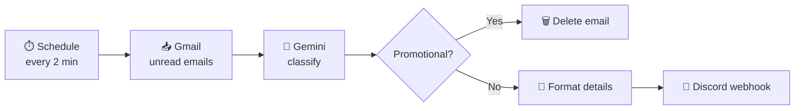

<!-- InboxPilot · README by Usama Shahid (fewgets) -->
<div align="center">


<p>
  
  
  
  
</p>

</div>

---
## 📌 Overview

**InboxPilot** is an **n8n** automation that keeps your Gmail inbox clean on its own. Every
2 minutes it reads new unread emails and asks **Google Gemini** to classify each one:

- 🗑️ **Promotional?** It's **deleted automatically**.
- 🔔 **Anything important?** A short summary (sender, subject, category, reason) is sent to your **Discord** channel.

No more digging through spam to find the OTP, the job reply or the bank alert you actually needed.

---

## ✨ Features

| | Feature |
|:-:|---|
| 📥 | Fetches unread emails from Gmail (OAuth2) |
| 🧠 | AI classification with **Gemini 2.5 Flash-Lite** |
| 🏷️ | 8 categories: `otp`, `security_alert`, `career`, `finance`, `transactional`, `personal`, `promotional`, `other` |
| 🗑️ | Promotional emails deleted automatically |
| 🔔 | Important emails pushed to Discord instantly |
| ⏱️ | Runs every 2 minutes in the background, fully hands-off |

---

## 🔄 Workflow



---

## ⚙️ Setup

### 1. Gmail API (OAuth2)
1. In [Google Cloud Console](https://console.cloud.google.com/), create a project and enable the **Gmail API**.
2. Create **OAuth2 credentials** (web application) with this redirect URI:
   `http://localhost:5678/rest/oauth2-credential/callback` (adjust for your n8n host).
3. In n8n, add a **Gmail OAuth2** credential and authorise your account.

### 2. Google Gemini
1. Create an API key in [Google AI Studio](https://aistudio.google.com/).
2. In n8n, add a **Google Gemini (PaLM)** credential.

### 3. Discord
1. In your server: **Channel Settings → Integrations → Webhooks → New Webhook**.
2. Paste the webhook URL into the workflow's **HTTP Request** node.

### 4. Import and activate
1. In n8n: **Workflows → Import** → `inboxPilot.json`.
2. Connect the three credentials, adjust the schedule if you like, and **activate**.

---

## 🧰 Tech Stack

| Component | Tool |
|---|---|
| Automation | [n8n](https://n8n.io) |
| Email | Gmail API (OAuth2) |
| AI | Google Gemini 2.5 Flash-Lite |
| Notifications | Discord webhooks |

```text
InboxPilot/
├── inboxPilot.json   # n8n workflow export
└── README.md
```

---

## 🤝 Let's Work Together

<div align="center">

**Have an idea, a freelance project, or want to collaborate on something in AI?**
I'm always open to collaborations, freelance work and full-time opportunities.

<a href="mailto:shaikhusama541@gmail.com?subject=Collaboration%20-%20InboxPilot">
  
</a>
<a href="https://www.linkedin.com/in/-usamashahid/">
  
</a>
<a href="https://github.com/fewgets">
  
</a>

<br/><br/>

⭐ **If you like this project, please give it a star. It really helps!** ⭐

<br/>

<h3>"Your inbox should work for you, not the other way round."</h3>


</div>
